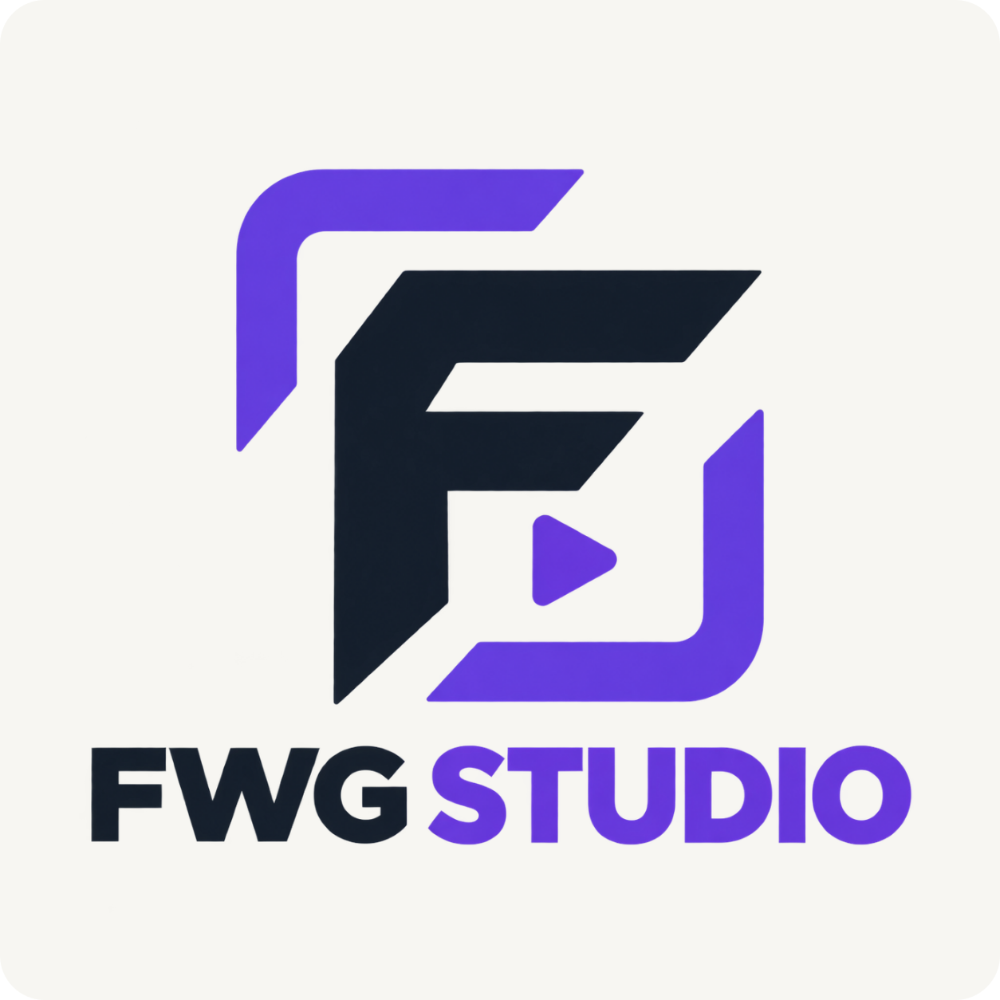
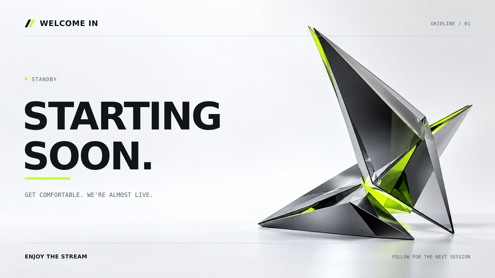
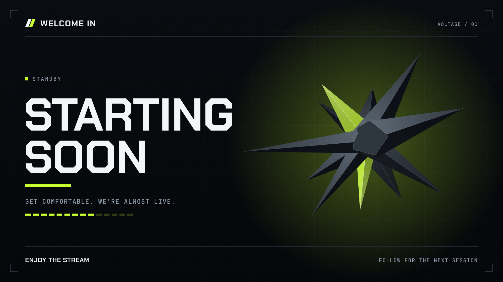
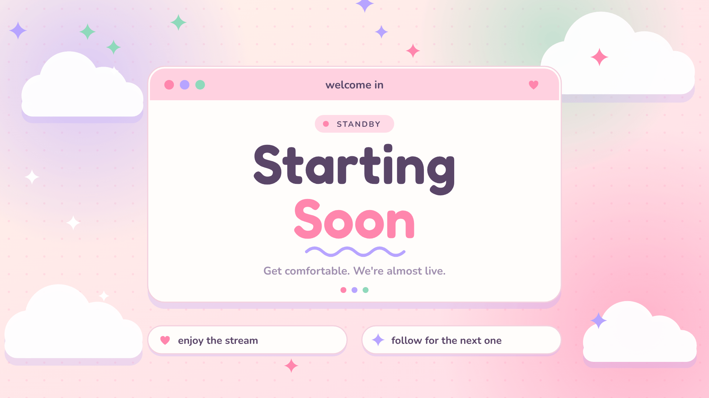
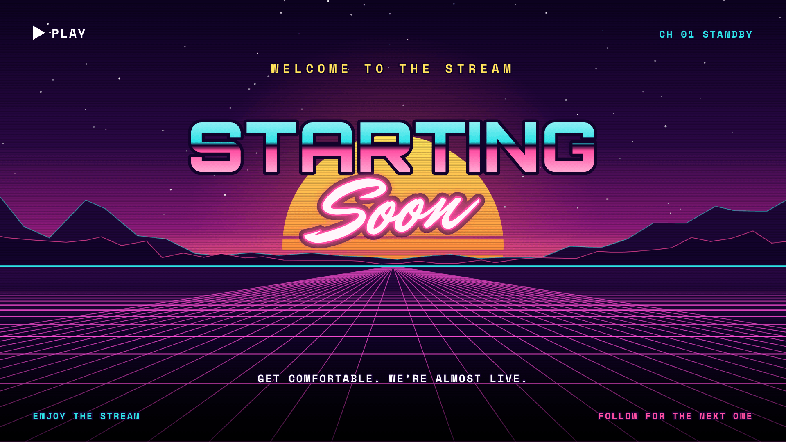
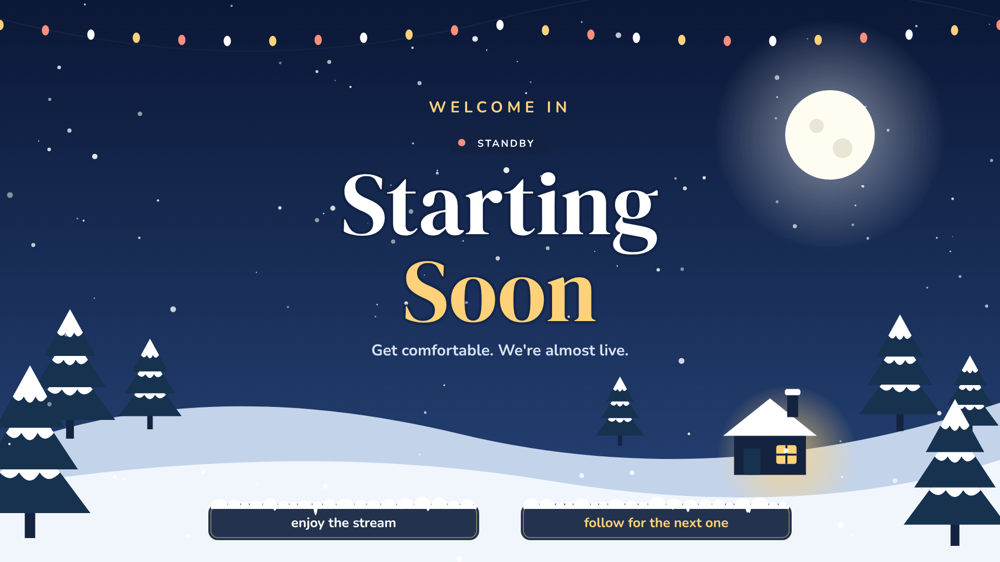

# FWG Studio · Free OBS Starting Soon screens

Official free samples from [FWG Studio](https://fwg.world/studio?via=github-obs-sample-20261008): five static Starting Soon screens for OBS, each with a matching About panel for your channel page. Every PNG is unwatermarked and uses generic text, so you can use it as supplied.

FWG Studio creates and maintains this resource. In the Gridline sample the abstract background artwork is AI-assisted, and the layout, typography, and UI graphics are part of the Studio composition. The Voltage, Cloudberry, Nightdrive, and Snowdrift samples are vector artwork generated from code written with AI assistance. See the original [licence](LICENSE.txt) and [attribution notice](ATTRIBUTION.txt).

## Preview

## Four more styles

| Voltage | Cloudberry |
| --- | --- |
|  |  |
| Dark HUD | Cozy pastel |

| Nightdrive | Snowdrift |
| --- | --- |
|  |  |
| Synthwave | Winter night |

## What you get

| Style | Starting Soon screen (1920 × 1080) | About panel |
| --- | --- | --- |
| Gridline | [assets/starting.png](assets/starting.png) | [assets/about.png](assets/about.png), 640 × 160 |
| Voltage | [assets/voltage-starting-soon.png](assets/voltage-starting-soon.png) | [assets/voltage-about-panel.png](assets/voltage-about-panel.png), 640 × 200 |
| Cloudberry | [assets/cloudberry-starting-soon.png](assets/cloudberry-starting-soon.png) | [assets/cloudberry-about-panel.png](assets/cloudberry-about-panel.png), 640 × 200 |
| Nightdrive | [assets/nightdrive-starting-soon.png](assets/nightdrive-starting-soon.png) | [assets/nightdrive-about-panel.png](assets/nightdrive-about-panel.png), 640 × 200 |
| Snowdrift | [assets/snowdrift-starting-soon.png](assets/snowdrift-starting-soon.png) | [assets/snowdrift-about-panel.png](assets/snowdrift-about-panel.png), 640 × 200 |

Use a Starting Soon screen as a full-screen, static scene in OBS. The About panels are designed to display at half their pixel size where your platform supports custom panel images.

These samples are static PNGs. They do not include editable SVGs, name personalization, a webcam frame, animation, chat, or alerts. The About panel belongs on your channel page; it is not a webcam overlay.

## Put the Starting Soon screen in OBS

Download this repository with **Code → Download ZIP**, extract it, and keep the folder somewhere permanent.

1. In OBS, create or select a scene named **Starting Soon**.
2. Under **Sources**, choose **+ → Image**, then select a Starting Soon PNG from the extracted `assets` folder, such as `assets/starting.png`.
3. Fit the image to your canvas, check that the text is visible, and make a short local recording before going live.

A 1920 × 1080 canvas matches the artwork. With a different canvas size, keep the image’s proportions and inspect the edges. [OBS Image sources support PNG](https://obsproject.com/kb/image-sources).

The screen’s “Starting Soon” text is artwork. You still choose when to start the broadcast and when to switch to your live scene.

See [the complete setup steps](docs/OBS-setup.md) for fitting, source order, audio checks, and adding the About panel.

## Use the About panel

Upload the About panel that matches your screen, such as `assets/about.png`, where your streaming platform supports a custom channel-panel image. Use the platform’s accompanying text field for your introduction, schedule, or channel details. The PNG’s generic “About” heading does not need a channel name to work.

## Want the whole pack?

Voltage, Cloudberry, Nightdrive, and Snowdrift are samples from full FWG Studio stream packs. Each pack is a one-time purchase with four scenes as PNG, animated HTML, and looping MP4; six overlays including webcam frames; fifteen channel panels; six animated alerts; a stinger transition; and a personalizer page that puts your channel name on every file. Find them on the [FWG Studio itch.io page](https://forgeworldgaming.itch.io/). No purchase is needed to use the free samples here.

## Prefer a scene with motion?

Read [Add animated overlays to OBS](https://fwg.world/studio/guides/animated-obs-overlays?via=github-obs-sample-20261008) to choose between a static Image source and a local HTML Browser source.

For hosted OBS themes, see [current FWG Studio membership plans](https://fwg.world/studio/pricing?via=github-obs-sample-20261008). Review the current billing terms and included features there before subscribing. Memberships do not include downloadable theme packs, editable SVGs, or local HTML source files. No membership or purchase is required to use this free sample.

## Licence and original guidance

The original [FWG Studio Free Sample Licence](LICENSE.txt) permits use and personalization on channels and social accounts you own or operate as one creator or business, including monetized streams. It restricts resale, sublicensing, and redistribution of the asset files. Public display within your channel output is permitted. Read the full licence before using or sharing the files; this summary does not replace it.

The original licence and attribution text are preserved unchanged, and the same licence applies to every sample in this repository. The original supplied setup guidance for Gridline is also retained in [docs/original-sample-readme.md](docs/original-sample-readme.md). No standalone font files are included in this repository.

OBS and streaming-platform names belong to their owners. No affiliation or endorsement is claimed.

