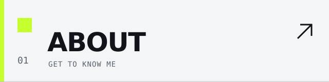

# FWG Studio · Free OBS Starting Soon screen

An official free Gridline sample from [FWG Studio](https://fwg.world/studio?via=github-obs-sample-20261008): a static Starting Soon screen for OBS and a matching About panel for your channel page. Both PNGs are unwatermarked and use generic text, so you can use them as supplied.

FWG Studio creates and maintains this resource. The abstract background artwork is AI-assisted; the layout, typography, and UI graphics are part of the Studio composition. See the original [licence](LICENSE.txt) and [attribution notice](ATTRIBUTION.txt).

## Preview

## What you get

| File | Dimensions | Use |
| --- | --- | --- |
| [assets/starting.png](assets/starting.png) | 1920 × 1080 | A full-screen, static Starting Soon scene in OBS |
| [assets/about.png](assets/about.png) | 640 × 160 | An About panel, designed to display at 320 × 80 where your platform supports custom panel images |

This sample contains two static PNGs. It does not include editable SVGs, name personalization, a webcam frame, animation, chat, or alerts. The About panel belongs on your channel page; it is not a webcam overlay.

## Put the Starting Soon screen in OBS

Download this repository with **Code → Download ZIP**, extract it, and keep the folder somewhere permanent.

1. In OBS, create or select a scene named **Starting Soon**.
2. Under **Sources**, choose **+ → Image**, then select `assets/starting.png` from the extracted folder.
3. Fit the image to your canvas, check that the text is visible, and make a short local recording before going live.

A 1920 × 1080 canvas matches the artwork. With a different canvas size, keep the image’s proportions and inspect the edges. [OBS Image sources support PNG](https://obsproject.com/kb/image-sources).

The screen’s “Starting Soon” text is artwork. You still choose when to start the broadcast and when to switch to your live scene.

See [the complete setup steps](docs/OBS-setup.md) for fitting, source order, audio checks, and adding the About panel.

## Use the About panel

Upload `assets/about.png` where your streaming platform supports a custom channel-panel image. Use the platform’s accompanying text field for your introduction, schedule, or channel details. The PNG’s generic “About” heading does not need a channel name to work.

## Prefer a scene with motion?

Read [Add animated overlays to OBS](https://fwg.world/studio/guides/animated-obs-overlays?via=github-obs-sample-20261008) to choose between a static Image source and a local HTML Browser source.

The optional [complete Gridline pack](https://fwg.world/studio/packs/gridline?via=github-obs-sample-20261008) is **C$29, one-time in CAD**. It includes 14 designs in PNG and editable SVG, an animated local HTML scene, and a local personalizer. Buying it is not required to use this free sample.

## Licence and original guidance

The original [FWG Studio Free Sample Licence](LICENSE.txt) permits use and personalization on channels and social accounts you own or operate as one creator or business, including monetized streams. It restricts resale, sublicensing, and redistribution of the asset files. Public display within your channel output is permitted. Read the full licence before using or sharing the files; this summary does not replace it.

The original licence and attribution text are preserved unchanged. The original supplied setup guidance is also retained in [docs/original-sample-readme.md](docs/original-sample-readme.md). No standalone font files are included in this repository.

OBS and streaming-platform names belong to their owners. No affiliation or endorsement is claimed.
